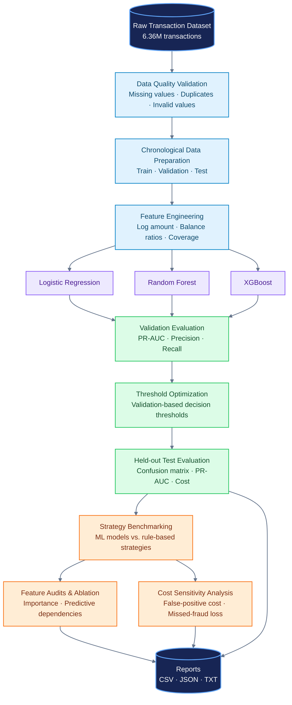

# FinTech Fraud Model Benchmark & Decision Engine

A machine learning project for benchmarking fraud detection models, optimizing decision thresholds, auditing transaction features, and comparing fraud detection strategies using business-cost assumptions.


<p align="center">
  
  
  
  
  
  <a href="https://github.com/Rauof-Qadir/fintech-fraud-model-benchmark/actions/workflows/tests.yml">
    
</a>
</p>
<p align="center">
  <b>Cost-sensitive fraud detection, model benchmarking, feature auditing, and threshold optimization.</b>
</p>

<p align="center">
  <a href="https://github.com/Rauof-Qadir/fintech-fraud-model-benchmark">Repository</a>
  ·
  <a href="https://github.com/Rauof-Qadir/fintech-fraud-model-benchmark/issues">Report an Issue</a>
</p>

---


## Overview

Fraud detection is an imbalanced classification problem: fraudulent transactions are rare, but failing to detect them can be costly. A model with high accuracy alone may still perform poorly at identifying fraud.

This project evaluates multiple machine learning models and rule-based strategies using precision, recall, F1-score, Precision-Recall AUC (PR-AUC), false positives, false negatives, and cost-sensitive analysis.

**Important:** The dataset used in this project is synthetic. Results demonstrate an experimental workflow and should not be interpreted as guaranteed performance on real banking transactions.

## Project Objectives

- Build and evaluate multiple fraud detection models.
- Use chronological train, validation, and test splits.
- Optimize classification thresholds using validation data.
- Compare machine learning models with rule-based strategies.
- Analyze feature importance and feature-ablation results.
- Investigate how false-positive costs and missed-fraud losses affect strategy selection.
- Add automated tests and data-quality checks.

## Technology Stack

- Python
- pandas and NumPy
- scikit-learn
- XGBoost
- DuckDB, where applicable
- pytest
- Git and GitHub

## Dataset

The project uses a PaySim-style synthetic transaction dataset.

| Property | Value |
|---|---:|
| Total transactions | 6,362,620 |
| Fraudulent transactions | 8,213 |
| Non-fraudulent transactions | 6,354,407 |
| Fraud rate | 0.1291% |
| Original columns | 11 |
| Zero-amount transactions preserved | 16 |

The dataset contains transaction attributes such as transaction type, amount, origin and destination balances, and fraud labels.

The original dataset is stored outside this repository. Its location is configured through the project's data-preparation configuration. Obtain the dataset separately and configure the appropriate input path before running the pipeline.


## Project Architecture

The pipeline moves from transaction-level data validation to chronological model evaluation and cost-sensitive decision analysis.



> **Evaluation note:** The dataset is synthetic, and exploratory rule analysis used test-set labels. Results from those exploratory rules are not an unbiased final estimate of production performance.

## Models Evaluated

### 1. Logistic Regression
A baseline classification model trained on the full training split, using feature scaling, categorical encoding, and class weighting.

### 2. Random Forest
An ensemble model trained on a stratified 500,000-row sample of the training split.

### 3. XGBoost
A gradient-boosted tree model trained on a stratified 500,000-row sample of the training split.

**Fair-comparison note:** Logistic Regression used the full training dataset, whereas Random Forest and XGBoost used a smaller sample. Their results therefore do not represent a perfectly controlled comparison of training data and compute requirements.

## Chronological Data Splitting

| Split | Transactions | Fraud cases | Fraud rate |
|---|---:|---:|---:|
| Train | 6,082,007 | 5,781 | 0.0951% |
| Validation | 191,147 | 1,180 | 0.6173% |
| Test | 89,466 | 1,252 | 1.3994% |

The fraud rate increases substantially over time. This distribution shift is important because model performance and the best operational decision threshold may change as transaction patterns evolve.

The validation split is used for model selection and threshold optimization. Test results should be interpreted cautiously because some later exploratory rule analyses were developed after examining test-set labels.

## Model Benchmark Results

The following results were measured on the chronological test split at the selected thresholds.

| Model | Threshold | PR-AUC | Precision | Recall | F1-score |
|---|---:|---:|---:|---:|---:|
| Logistic Regression | 0.65 | 0.7805 | 23.33% | 99.36% | 0.3778 |
| Random Forest | 0.20 | 0.9973 | 98.80% | 99.04% | 0.9892 |
| XGBoost | 0.07 | 0.9931 | 95.18% | 99.36% | 0.9723 |

These metrics are specific to this synthetic dataset and experimental setup. They are not estimates of expected performance on production banking data.

## Cost-Sensitive Decision Analysis

The project compares detection strategies using configurable assumptions for:

- False-positive investigation cost.
- Loss associated with missed fraud.
- The proportion of estimated fraud loss used in a scenario.
- Classification thresholds selected on validation data.

The analysis includes Logistic Regression, Random Forest, XGBoost, an exact-balance-match rule, and a balance-coverage rule.

The cost sensitivity experiment varies false-positive costs across 5, 25, 50, and 100 units and missed-fraud loss multipliers across 10%, 25%, 50%, and 100%.

**Cost units are illustrative, not verified USD or actual bank losses.** Strategy rankings depend on the selected assumptions; there is no universally optimal strategy without a validated business cost model.

## Feature Engineering and Auditing

Engineered features include:

- Log-transformed transaction amount.
- Transaction amount relative to the origin balance.
- Transaction amount relative to the destination balance.
- Whether the origin balance covers the transaction amount.

Feature audits and ablation experiments investigate how these features affect predictive performance.

Some engineered features are extremely predictive in this synthetic dataset. That does not automatically mean the same relationships will generalize to real financial transactions. Their meaning, availability at decision time, and potential leakage risks require careful validation.

## Repository Structure

```text
fintech-fraud-model-benchmark/
├── configs/
│   └── config.yaml
├── data/
├── dashboard/
├── models/
├── notebooks/
├── reports/
├── src/
│   ├── data.py
│   ├── prepare_data.py
│   ├── train_logistic.py
│   ├── train_random_forest.py
│   ├── train_xgboost.py
│   ├── evaluate_test.py
│   ├── optimize_threshold.py
│   ├── feature_importance.py
│   ├── cost_sensitivity_analysis.py
│   └── ...
├── tests/
├── requirements.txt
└── README.md
```

## Setup

Create and activate a virtual environment.

```powershell
python -m venv .venv
.\.venv\Scripts\Activate.ps1
python -m pip install --upgrade pip
pip install -r requirements.txt
```

Configure the dataset path in `configs/config.yaml` according to the project's data-preparation code.

## Run Tests

```powershell
python -m pytest -q
```

The latest local verification passed 16 tests. Run the tests again after making changes to verify the current state.

## Run Data Quality Validation

```powershell
python -m src.data
```

This command validates the raw transaction dataset and generates the data-quality report configured by the project.

## Reproducibility and Limitations

- The dataset is synthetic and may not reflect real fraud behavior.
- The chronological splits have substantially different fraud rates.
- The models use different training sample sizes.
- Thresholds and cost assumptions affect the resulting strategy rankings.
- Exploratory rules evaluated after examining test labels must not be presented as unbiased final test results.
- Feature importance indicates predictive usefulness, not causation.
- Production deployment would require independent real-world validation, monitoring, security controls, and ongoing drift evaluation.

## Future Improvements

- Add a controlled model comparison using the same training sample and feature set.
- Strengthen leakage and feature-availability audits.
- Add cross-period and drift monitoring.
- Create a reproducible experiment configuration and results export.
- Build an interactive dashboard for comparing models and business-cost scenarios.
- Validate assumptions using realistic operational costs and independent data.

## Author

**Rauof Qadir**

Software Engineer | Data Science | Machine Learning | FinTech Risk Analytics

GitHub: [Rauof-Qadir](https://github.com/Rauof-Qadir)

---

*This project is an educational and portfolio-oriented machine learning experiment, not a production-ready banking fraud prevention system.*


## Final Cost-Aware Audit

The project includes validation-selected cost thresholds and a test evaluation
across three models and 16 illustrative business-cost scenarios per model.

Additional experiment scripts:
- `src/audit_balance_identity.py` ? investigates origin-balance patterns.
- `src/controlled_ablation.py` ? compares selected feature groups.
- `src/origin_feature_ablation.py` ? investigates origin-feature dependencies.
- `src/cost_aware_thresholds.py` ? selects thresholds using validation costs.
- `src/evaluate_cost_aware_test.py` ? evaluates selected thresholds on test data.
- `src/compare_balance_rule.py` ? compares balance-based rules and ML models.

The consolidated local audit is generated at
`reports/final_cost_aware_model_audit.csv`. Generated reports are not generally
tracked by Git because the `reports/` directory is ignored; selected final
artifacts can be explicitly added when appropriate.

**Evaluation caveat:** the chronological test split was examined in multiple
exploratory analyses. Treat those comparisons as exploratory, not as an
untouched final holdout or an unbiased estimate of production performance.
A fresh future-period dataset is needed for stronger independent evaluation.

